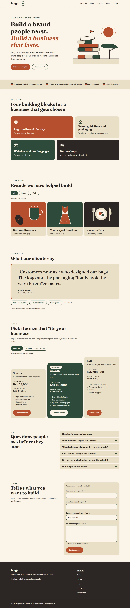
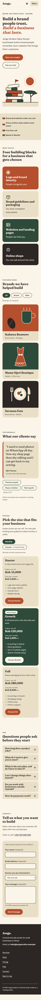
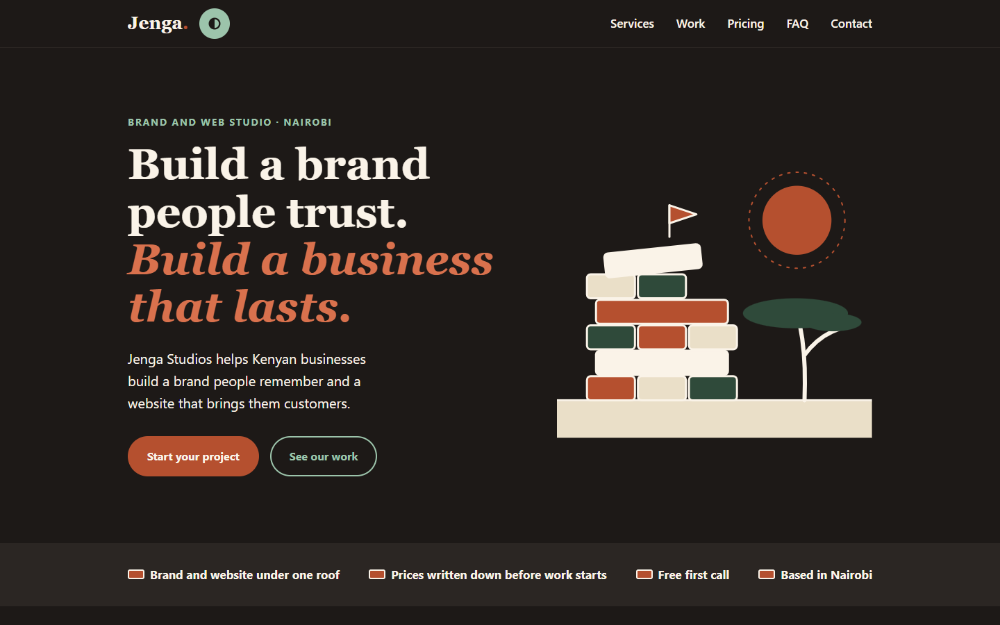
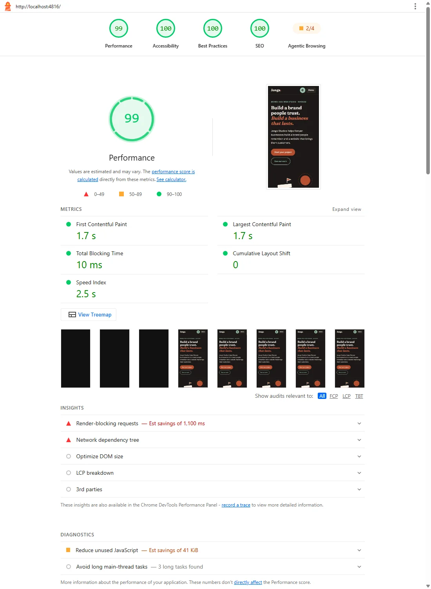

# Jenga Studios: landing page (Crepton Task 1)

A landing page for a fictional digital studio. Everything here is invented: no real client, company or asset.

**Live site:** https://studio-landing-omega.vercel.app/ (deployed on Vercel from `main`)
**Pull request:** https://github.com/Danny3929/studio-landing/pull/1

> Status (2026-11-01): the page is built and checked (see "Final checks"). Built: navigation bar with theme button, Hero, trust strip, Services, Work (with filter), Testimonials carousel, Pricing (with monthly/annual toggle), FAQ accordion, Contact form (validates, demo only, tap-to-call number), footer, light/dark theme, favicon, `robots.txt`, scroll fade-in (off for reduced motion). Still to do: put the code on GitHub, deploy to Vercel, test the live URL on a real phone, and re-measure Lighthouse on the live URL.

## Design decisions

### The studio
- **Name:** Jenga Studios. *Jenga* is Swahili for "build".
- **Why this name:** the studio builds brands and websites, and "jenga" means build. It also names a stacking game, so the name, the brick-style layout and the tower-of-bricks drawing in the Hero all say the same thing.
- **Idea:** a brand identity and web studio for small businesses in Kenya, so they look as good as they work.
- **Services (4):**
  1. Logo and brand identity
  2. Brand guidelines and packaging
  3. Websites and landing pages
  4. Online shops
- **Pricing:** three tiers (Starter, Growth, Full). Project work is a one-off price. The monthly/annual toggle applies to a care plan (hosting and updates).

### Three reference sites (draft, to be confirmed by Dan)
| Site | What I will borrow | What I will not copy |
|---|---|---|
| Aesop | Calm serif headings, warm tones, generous white space | Its heavy product photography |
| Pentagram | A confident, simple featured-work grid | Its very plain navigation |
| Stripe | Three pricing cards with the middle one highlighted | Its busy gradients |

### Hero wording (chosen 2026-10-27)
- **Headline:** "Build a brand people trust. Build a business that lasts."
- **Supporting line:** "Jenga Studios helps Kenyan businesses build a brand people remember and a website that brings them customers."
- **Why this wording:** the first draft ("Build a brand that commands respect. Build a digital presence that converts.") was replaced because of its length. Measured in a real browser: the first draft took 6 lines on both a 390px phone and a 1280px laptop, and on a standard 1280 x 800 laptop window the "Start your project" button ended below the bottom of the screen (822px of 800px). The chosen wording takes 4 lines on both, and the buttons end at 686px of 800px. It also avoids marketing words ("converts", "scale") and claims we cannot prove yet ("high-performance", "commands respect").

### Fonts (both free on Google Fonts)
- Headings: **Fraunces**, a warm serif.
- Body: **DM Sans**, clean and readable at small sizes.

### Colours (light theme; dark theme below)
| Job | Colour | Hex |
|---|---|---|
| Page background | Cream | `#FAF3E8` |
| Main text | Charcoal | `#2B2623` |
| Call-to-action button | Terracotta (cream text) | `#B5502F` |
| Accent (links, tags, icons) | Deep green | `#2F4A3A` |
| Soft background (cards, strips) | Sand | `#EADFC8` |

The dark theme is described in the next section, with its measured contrast.

### Dark theme (added 2026-10-28)
The theme follows the visitor's system setting until they press the button; then their choice is saved in the browser (`localStorage`, key `jenga-theme`, value `light` or `dark`) and wins. A small script in `index.html` sets the theme before the page paints, so there is no white flash.

The dark theme only changes the *role* tokens in `src/styles/tokens.css` (`[data-theme='dark']`). Our five palette colours stay. Two lighter shades were added so that text passes 4.5:1 on a dark page, and one very dark page colour:

| Job | Dark value | Contrast on the dark page (#1d1917) |
|---|---|---|
| Page background | #1d1917 (a darker charcoal) | n/a |
| Text | cream #faf3e8 | 15.83:1 |
| Cards and form | charcoal #2b2623 | cream text on it 13.57:1 |
| Accent (links, eyebrows, buttons) | #9cc4ab (a lighter green) | 9.05:1 |
| Highlight (terracotta used as text) | #d9714d (a lighter terracotta) | 5.33:1 |
| Call-to-action button | terracotta #b5502f with cream text | 4.59:1 (unchanged) |

Terracotta text directly on the dark page is only 3.45:1, which is why the highlight shade exists. The services bricks, work tiles and footer keep their palette colours in both themes. The Hero drawing uses an `--color-ink` outline (charcoal in light, cream in dark).

### Contrast check (light theme)
Calculated with the WCAG contrast formula (script run on 2026-10-24). Body text needs at least 4.5:1.

| Text on background | Ratio | Result |
|---|---|---|
| Charcoal on cream | 13.57:1 | Pass |
| Charcoal on sand | 11.31:1 | Pass |
| Cream on terracotta (button) | 4.59:1 | Pass, but close to the limit |
| Terracotta on cream | 4.59:1 | Pass, but close to the limit |
| Deep green on cream | 8.81:1 | Pass |
| Deep green on sand | 7.35:1 | Pass |
| Cream on deep green | 8.81:1 | Pass |
| **Terracotta on sand** | **3.83:1** | **Fail** |

**Rule from this check:** never put terracotta **text** on the sand background (needs 4.5:1, gets 3.83:1). Use deep green or charcoal for text there. Terracotta **graphics** (icon accents, shapes) on sand are allowed, because graphics only need 3:1 and 3.83:1 passes. Only the real page, checked in Lighthouse, will prove the final result.

### Drawings (illustration rules)
Checked on 2026-10-24 against the tokens above, for the hero tower, the four service icons and the three featured-work pictures:
- **Colours:** only the five palette colours, written as tokens (`var(--green)`), never hex values or blended tints. On dark or terracotta backgrounds, icons use cream outlines and sand accents. Pure white is not allowed.
- **Line weight:** every outline is 3px on screen at any size (the SVGs use `vector-effect: non-scaling-stroke`). Shapes drawn with a stroke (the acacia trunk, the cutlery) are 6px. Fine dashes are 2px.
- **No cropping:** pictures are fitted inside their frame (`preserveAspectRatio="xMidYMid meet"`), never cut off.
- **Accessibility:** purely decorative drawings (icons, featured-work pictures) are hidden from screen readers with `aria-hidden="true"`. The hero tower has a text label. The caption under each picture carries the meaning.

### Layout direction: "Bricks" (chosen 2026-10-24)
Three directions were sketched: A (Editorial), B (Bricks) and C (Immersive green). **B was chosen** because the layout itself carries the name *Jenga* (build, stack, blocks):
- a brick-course band under the hero;
- services shown as coloured bricks of different widths;
- featured work in a staggered grid;
- pricing as a staircase that grows with each tier.

Why B and not A or C: A (Editorial) is calm and elegant but could belong to any studio, and C (Immersive green) is bold but drops the tower drawing. Only B makes the name visible in the layout itself: a visitor sees bricks stacking up as they scroll, which is the idea of the business (build something solid, piece by piece).


### Spacing
An 8px scale: 8, 16, 24, 32, 48, 64, 96.

## Screenshots

Desktop (1280 px, light theme — full page):



Mobile (390 px, light theme — full page):



Dark theme (hero section, 1440 px):



## Lighthouse

Measured on 2026-11-01 against the final build (`npm run build`), served locally with `npx vite preview`, mobile preset, Lighthouse 13.6.0 via Node. Seven runs.

| Category | Score (range over 7 runs) | Target |
|---|---|---|
| Performance | **94 to 97** | 90 |
| Accessibility | **100** | 90 |
| Best Practices | **100** | 90 |
| SEO | **100** | 90 |

Key speed numbers: First Contentful Paint 1.8 to 2.1 s · Largest Contentful Paint 1.8 to 2.1 s · Total Blocking Time 0 to 40 ms · Cumulative Layout Shift 0 to 0.095.

The full report of the last run is saved at `docs/lighthouse-report.html`. A screenshot of it (Performance 94, the lowest of the seven runs):



**How to read these numbers honestly**
- **All seven runs measured the dark theme.** Lighthouse's headless Chrome follows this PC's colour setting, which is dark. I tried a Chrome flag to ask for the light theme, but Lighthouse's own screenshot of those runs still shows the dark page. The light theme was checked for contrast with our own script (every visible text at least 4.5:1) but not with Lighthouse.
- **Layout shift is close to the limit.** In three runs it was 0; in the other four it was 0.093 to 0.095, and the "good" limit is 0.1. The only element Lighthouse reports as moving is the Hero drawing, which shifts when the web fonts finish loading and the text above it changes height. The likely fix is to host the two fonts on the site instead of loading them from Google Fonts (Lighthouse also lists the Google Fonts stylesheet as render-blocking, an estimated 1.4 s). That is not done.
- Before the favicon and `robots.txt` were added (28 October), Best Practices was 96 (a 404 for `favicon.ico`) and SEO was 91 (no valid `robots.txt`).
- Lighthouse 13.6 also shows an extra "Agentic Browsing" category (2/4). It is not one of the four categories in the task, so it is not part of this table.
- The table above is from local runs. The live-site runs are below.

**On the live URL (2026-11-03):** three mobile runs against https://studio-landing-omega.vercel.app/, run from my own PC, so my own connection affects the speed numbers. Performance 94, 93, 94. Accessibility, Best Practices and SEO 100 in all three. Largest Contentful Paint about 2.2 to 2.3 s. Layout shift 0.093 to 0.095, still just under the 0.1 limit.

**To rerun:**

```
npm run build
npx vite preview --port 4815
# in a second terminal, from %TEMP%\lh-tool:
node node_modules/lighthouse/cli/index.js http://127.0.0.1:4815/ --output html --output-path docs/lighthouse-report.html --form-factor mobile --chrome-flags="--headless --no-sandbox"
```

## Explain-it

### 1. Why did you structure your components the way you did? What would you split further?

I am new to React, so I started by asking myself: what are the sections I can see on the page? Each one became its own component, which is just a piece of the page kept in its own file (Nav, Hero, Services, Work, Testimonials, Pricing, Faq, Contact, TrustStrip, Footer). That way, if something looks wrong in the pricing, I know to open the pricing file and not hunt through one giant file.

I also learned it is better not to type the words and prices straight into the component. So the text for each section sits in a list in the `src/data/` folder. To change a price I only edit that list and the page updates. To check that this really works, I added a fifth service, a seventh FAQ question and a new filter in temporary copies, and the page still looked right.

Some things need extra care for keyboard users, like the menu that must keep focus inside it, and the carousel that should stop moving when you focus it. I put those in five small files called hooks (`useMenuKeys`, `useTheme`, `useCarousel`, `useContactForm`, `useScrollReveal`). A hook is a function that holds the behaviour, and I understand it as "the logic lives here, the looks live in the component". The guide says to keep components under about 150 lines, and the longest of my 22 is 103. All colours, spacing and fonts come from one file, `src/styles/tokens.css`, and I checked there are no colours typed directly anywhere else.

What I would split next: `Hero.jsx` is 89 lines but 58 of them are the brick-tower drawing, so the drawing should be its own `HeroArt` component. `WorkArt.jsx` has three drawings in one file, so each should get its own file. `ContactForm.jsx` (103 lines, my biggest) does the form and the thank-you message, which are two jobs. And I copied the small "eyebrow" label style into seven stylesheets, which I now know I should have made one shared class.

### 2. Which accessibility problem did you find and fix, and how did you find it?

Accessibility, as I understand it now, means people can use the site even if they cannot use a mouse or cannot see well. The clearest problem I found was the focus ring in the footer. The focus ring is the outline that shows where you are when you press Tab. My green ring looked fine on the cream pages, but on the dark charcoal footer it measured only 1.54:1 for contrast, and it needs at least 3:1. So a keyboard user would basically lose their place.

I did not spot it by eye. I learned that contrast can be measured as a number, so a script read the real colours of every ring and background in the browser and worked out the ratio. The fix was a cream ring 3px thick, which measured 13.57:1. The same measuring found two more problems: error text in terracotta on the sand-coloured form was 3.83:1 (text needs 4.5:1), so errors are now charcoal and only the "!" sign and border are terracotta. And in dark theme the terracotta text was 3.45:1, so small terracotta text uses a lighter shade there.

A second problem was about order. I had made the middle pricing card show first on phones using the CSS `order` property. I learned that this only changes what you see, not the order Tab goes through, so a keyboard user would start on a different card than the one at the top. A test in a real browser caught it, and I removed the reordering instead of loosening the test. At the end I walked through the whole page with only the Tab key: 40 stops on a laptop and 36 on a phone, in light and dark. Every stop had a visible ring, nothing was hidden behind the sticky bar, and I never got stuck. Details are in "Final checks" below.

### 3. What did the AI get wrong, and how did you notice?

I am learning that AI helpers sound sure even when they are wrong, so I try to check them. Each of these is written down with a date in `NOTES.md`.
1. **The brick layout put each service in a fixed column number.** When I added a fifth service as a test, the fifth brick shrank to 234px and the others changed width. The real data would never have shown that, but the test with extra data did. It now repeats a width pattern, so any number of services fits.
2. **The carousel Next and Previous buttons used an old value from the last render.** I do not fully understand why yet, but three quick clicks moved it only once. I noticed because a screenshot said "Quote 2 of 4" after three clicks. It now updates from the previous value.
3. **Some of the AI's own tests proved nothing.** A "fonts blocked" test passed only because the browser had saved the fonts already, a "blank headline" test looked at the wrong server, and some checks passed on an empty list. I learned to ask "can this test fail?" and to break the page on purpose to see.
4. **Another AI (Gemini) said my text contrast was too low,** and it also thought the dress drawing was hanging on a hanger. When I measured, every text pair passed (the lowest is 4.59:1), so it was wrong. Now I treat AI feedback as a list of things to check with numbers, not as the final word.
5. **Early on, the AI told me nothing had been chosen for the studio name,** because it had not read the proposal saved by another session. I noticed because I remembered it had been chosen.

## Final checks (2026-11-01)

Run on the final production build, in a real Chrome driven by scripts. The numbers below are from those runs.

**Secrets, packages and files**
- No `.env`, key or credential file is tracked in git, and `.gitignore` keeps `.env` files out (`.env.example` would be allowed). A scan for key-like text (AWS, Stripe, GitHub tokens, private keys, `api_key = "..."`) found nothing in the current files or in any of the 76 commits. The only phone number and email in the source are invented (`+254 700 000 000` and `hello@jengastudios.example`).
- No unused packages: the project has four (`react`, `react-dom`, `vite`, `@vitejs/plugin-react`) and each is used. `npm audit` reports 0 vulnerabilities and `npm outdated` lists nothing.
- No unused files: all 52 files in `src/` are reachable from `main.jsx` by following imports.
- No hard-coded colours outside `src/styles/tokens.css` (0 found).

**Console errors:** in four full runs (1280px and 390px, light and dark) I scrolled the whole page, used every filter, toggle, carousel button and FAQ question, and sent the contact form empty and filled in. Result: 0 console errors, 0 warnings, 0 exceptions and 0 failed network requests.

**Keyboard-only walkthrough:** from a freshly loaded page I pressed Tab through everything: 40 stops at 1280px and 36 at 390px. Every stop has a solid 3px focus outline, is scrolled into view (a tall text box needs its top edge and at least half of itself), is not hidden behind the sticky bar or covered by anything, has a readable name, and follows reading order (top to bottom, left column before right). Focus leaves the page at the end, so there is no trap, and Shift+Tab visits the same stops in exactly the opposite order. Each control also works from the keyboard: theme button (Enter and Space), work filter, billing toggle, carousel Next and Pause, FAQ questions (Enter opens, Space closes), and the contact form (Enter on Send shows the errors and moves focus to the first problem; a filled form shows the thank-you message).

**Test suites on the final build:** navigation 21 checks, services 18, work 22, hero 10, carousel 10 (it changes quote every 5000 ms, and pauses on focus, on hover and with the Pause button; with reduced motion it never rotates), and the keyboard and console walkthrough 24 checks in each of the four runs. Every check passed. The checks can fail: with the focus outline removed and a deliberate console error added in a temporary copy, the walkthrough failed 2 checks. Not re-run in detail: the older suites for pricing, FAQ, contact form, theme and footer (their scripts were not in my working folder). The walkthrough above covers their keyboard use and console output in both themes.

**Known gaps:** the live site is deployed and measured with Lighthouse, but I have not yet tested it on a real phone (only Chrome's phone emulation). The contact form is a demo (nothing is sent). Nothing in the code guards against empty text in the data files (for example an empty Hero headline would leave an empty heading). Lighthouse measured only the dark theme, and layout shift is close to its limit (see "Lighthouse").

## Scroll animations
Services, Work, Testimonials, Pricing, FAQ and Contact fade in and rise 16px once (0.5 s) as they scroll into view. The Hero, trust strip and footer do not animate. Sections stay fully visible when the visitor prefers reduced motion, when `IntersectionObserver` is missing, when scripts fail, and in print. Keyboard focus or a link jump into a hidden section reveals it at once. Only opacity and transform change, so nothing moves in the layout. Code: `src/hooks/useScrollReveal.js` and `src/styles/reveal.css`.
Checked in a real browser (14 checks, all pass), including: no layout shift, reveal on focus and on a nav jump, reduced motion, no `IntersectionObserver`, print. Break test: removing both reduced-motion safeguards made the reduced-motion and print checks fail. The earlier section suites and Lighthouse were re-run afterwards on the final build (see "Final checks" and "Lighthouse").
